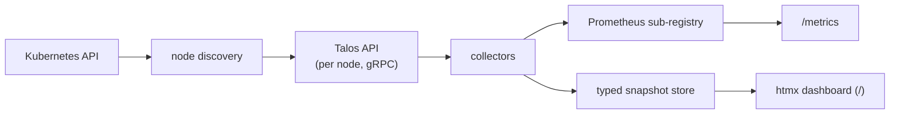

# talos-monitoring

A Prometheus exporter and htmx dashboard for [Talos Linux](https://www.talos.dev)
node hardware and OS health. One pod, no DaemonSet, nothing installed on the
node.

Talos has no shell and nothing you can install on the node, so the usual
privileged node-exporter DaemonSet is out. But every node already serves a gRPC
machine API (the one `talosctl` uses), so a single Deployment dials each node's
API directly and reads it in-cluster through a Talos ServiceAccount. That
also reaches what node_exporter never had: per-DIMM and per-socket inventory,
PCI devices, Talos service health, boot stage, volume encryption, and kernel
parameters vs. their defaults.

## Design



A scheduler polls each collector on its own TTL (seconds for live data, an hour
for inventory) and writes both outputs. `/metrics` and the dashboard only read
that state, so neither triggers a Talos API call, and the app never changes
node state.

## Prerequisites

Enable in-cluster Talos API access on **every node** by adding this document to
the machine config (e.g. `talosctl patch machineconfig --patch @talos-api-access.yaml`):

```yaml
apiVersion: v1alpha1
kind: KubeTalosAPIAccessConfig
allowedRoles:
  - os:reader
allowedKubernetesNamespaces:
  - talos-monitoring   # the app's namespace
```

Older Talos versions use the deprecated `machine.features.kubernetesTalosAPIAccess`
block instead (`enabled: true` plus the same two lists); set one or the other,
not both.

The Helm chart creates the `talos.dev/v1alpha1` ServiceAccount; Talos turns it
into a Secret with a short-lived (6 h, auto-renewed) client certificate, which
the pod mounts as `TALOSCONFIG`.

> **Roles:** `os:reader` is enough for everything except what reads node files
> (sensors, GPU counters, PCI sysfs enrichment, the per-core CPU frequency
> fallback), which needs `os:admin`; without it those reads pause and re-probe every 5
> minutes, so granting the role later needs no restart. To enable them, set
> Helm `talos.roles` and `allowedRoles` above to `[os:admin]` — the app stays
> read-only, but that credential is not.

> **Omni:** Omni owns the machine config, so it rejects `os:admin` in
> `allowedRoles` patches and strips it from the configs it generates; a hand
> patch only lasts until Omni's next config push. On Omni-managed clusters the
> app therefore runs on `os:reader`. To get the `os:admin` parts, point
> `TALOSCONFIG` at a talosconfig that dials through Omni's Talos API proxy with
> an Omni identity instead of the in-cluster ServiceAccount.

## Running it

### Helm

```sh
helm install talos-monitoring oci://ghcr.io/yuriy-kovalchuk/charts/talos-monitoring \
  --version <version> \
  --namespace talos-monitoring --create-namespace
```

The pod reaches 1/1 Ready. Until Talos API access is enabled on the nodes it
stays 0/1 and logs `talosconfig unavailable, retrying` — expected, not a crash.
Values are documented in `charts/talos-monitoring/values.yaml`; full examples,
including the local chart with a self-built image, are in [`examples/`](examples/).

### Locally

```sh
make run                                         # default talosconfig and kubeconfig
make run TALOSCONFIG=~/.talos/config-admin       # another talosconfig, e.g. an os:admin one
make run KUBECONFIG=~/.kube/other LISTEN=:9090   # another cluster or port
```

Without overrides it uses `$KUBECONFIG`/`~/.kube/config` and
`$TALOSCONFIG`/`~/.talos/config`. `./bin/talos-monitoring serve --help` lists
every flag.

### Releasing

1. Set `version` and `appVersion` in `charts/talos-monitoring/Chart.yaml` to the
   release without the `v` (`0.2.0`).
2. Rename `[Unreleased]` in `CHANGELOG.md` to that version and today's date.
3. Commit and push the tag `vX.Y.Z`. CD runs the CI checks, refuses a tag that
   does not match `Chart.yaml` or has no changelog section, and publishes the
   signed image (`:X.Y.Z`, `:vX.Y.Z`, `:latest`), the chart and a GitHub Release.

## Metrics and dashboards

- [`docs/METRICS.md`](docs/METRICS.md) — every exported metric, kept in sync
  with the code by a test.
- [`docs/built-in-dashboard.md`](docs/built-in-dashboard.md) — the dashboard at
  `http://<host>:8080/`: current state plus a short in-memory history, no
  charts, works without Prometheus.
- [`docs/grafana-dashboards.md`](docs/grafana-dashboards.md) — the Grafana
  dashboards shipped with the chart, for long-term history, trends and alerting.

## GPUs

Every GPU is reported with its model, PCI address and bound driver on
`os:reader`. Live counters depend on the vendor:

| | AMD (`amdgpu`) | NVIDIA |
|---|---|---|
| Identity and bound driver | ✅ `os:reader` | ✅ `os:reader` |
| Utilisation, VRAM, GTT | ✅ `os:admin` (sysfs) | ❌ |
| Temperature, fan, power | ✅ `os:admin` (hwmon) | ❌ |

The NVIDIA driver writes no counters to sysfs or hwmon; it only answers NVML
calls made by a process on the node. The Talos API can read files but not
make those calls, so no role unlocks them. For NVIDIA counters, run NVIDIA's
[`dcgm-exporter`](https://github.com/NVIDIA/dcgm-exporter) on GPU nodes
alongside this app.

## Security

The dashboard and `/metrics` are **unauthenticated** and expose hardware
identifiers (chassis serials, system UUIDs, DIMM serials, disk WWIDs) as labels.
The chart ships no NetworkPolicy — restricting access is up to you.
