# Built-in dashboard screenshots

A look at the built-in htmx dashboard (`http://<host>:8080/`), in light and
dark (the theme follows your OS, or cycle it with the toggle in the top bar).
Each page is shown in light, with a link to its dark version. It reports
current state plus a short in-memory history. Samples like the CPU
frequency range are kept in RAM for the last **10 minutes** by default
(`--history.window`, Helm `scrape.historyWindow`), enough to smooth out a live reading without hammering
`/metrics`. There are no long-range charts in this UI by design.

For persistent, long-term metrics history beyond that window, trends, and
alerting, use the Grafana dashboards that ship with the Helm chart,
scraping `/metrics`. Screenshots of those are in
[`grafana-dashboards.md`](grafana-dashboards.md).

See [`README.md`](../README.md) for the design rationale and
[`METRICS.md`](METRICS.md) for the metric reference.

## Cluster overview

Fleet-wide summary: attention banner, hardware totals, per-node system
status, and a nodes table.

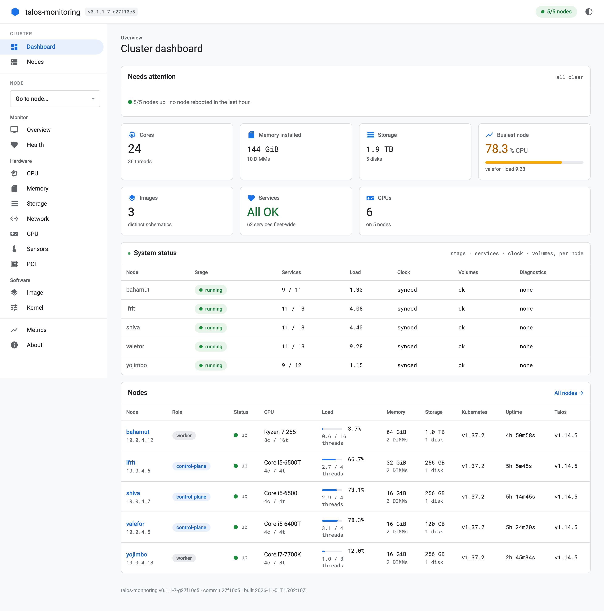

[Dark theme](assets/ui/dashboard-overview-dark.png)

## Nodes

All discovered nodes with role, OS/arch, kubelet and Talos versions, and
status.

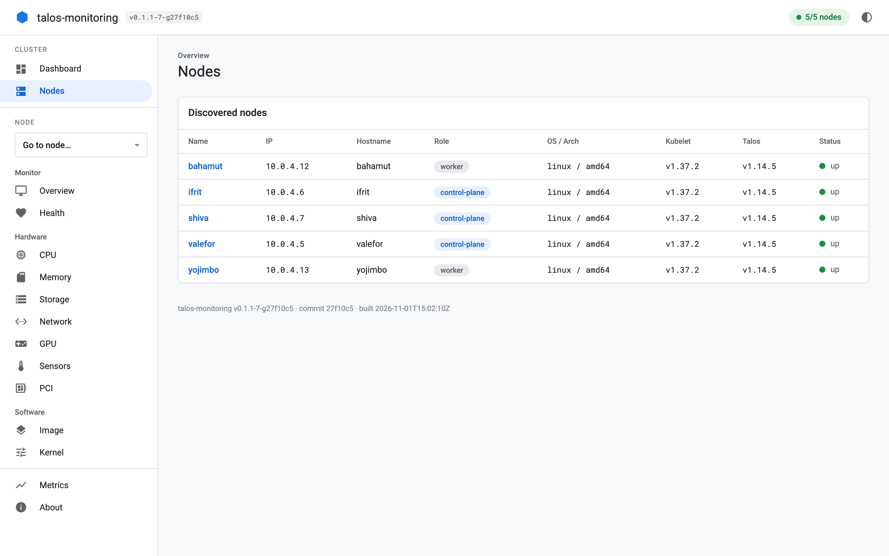

[Dark theme](assets/ui/nodes-list-dark.png)

## Node overview

Per-node landing page: CPU, memory, service and hottest-sensor tiles, the
machine and system summaries, and a card per hardware and software section.

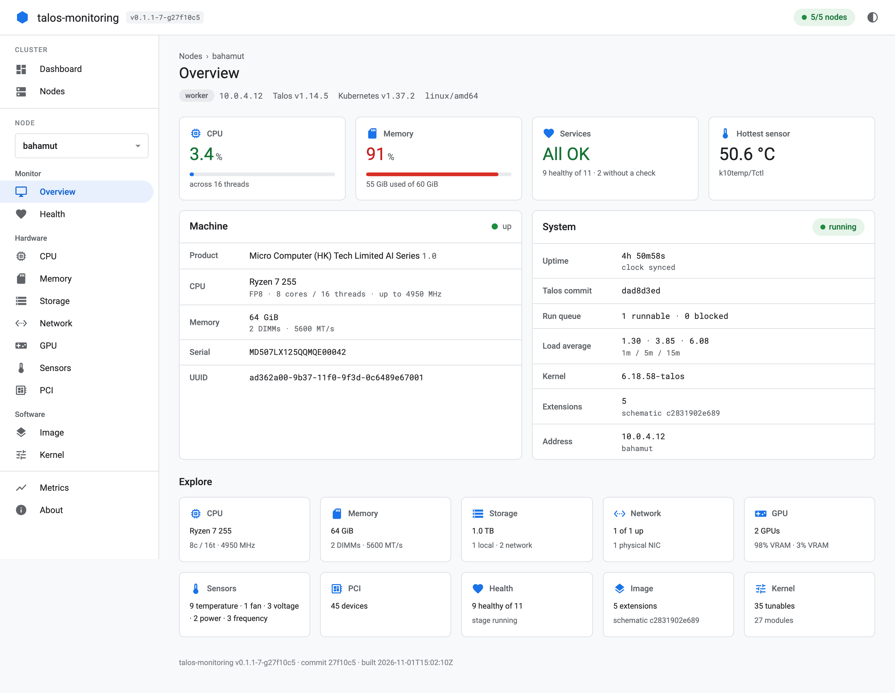

[Dark theme](assets/ui/node-overview-dark.png)

## Health

Machine stage, service health, clock sync, per-service state, and etcd
leader, quorum and alarms on control-plane nodes.

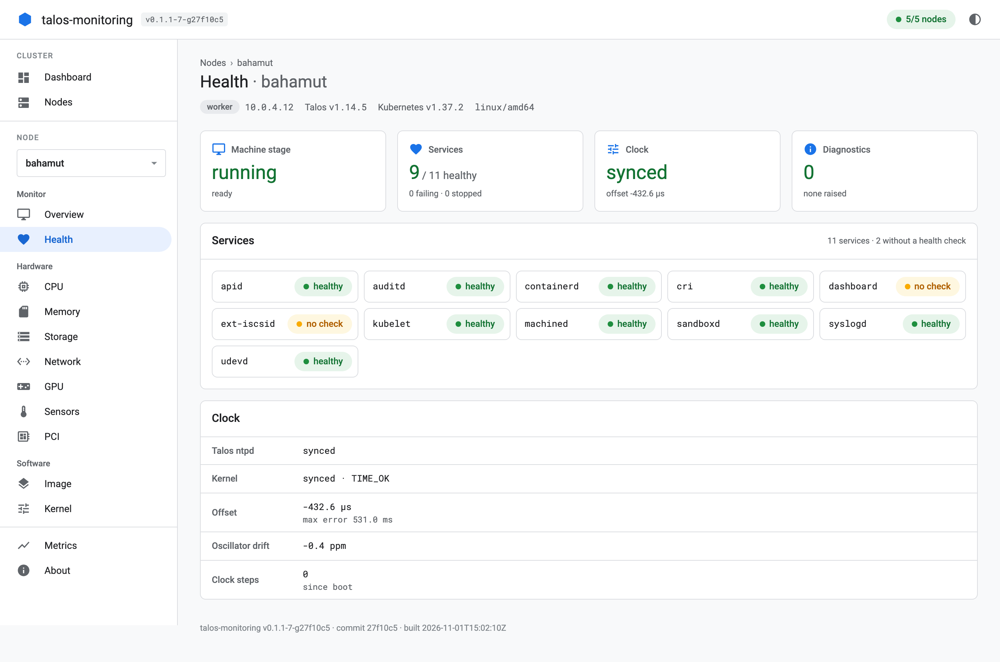

[Dark theme](assets/ui/node-health-dark.png)

## Image

Schematic, boot entry, installed system extensions, and secure boot
posture.

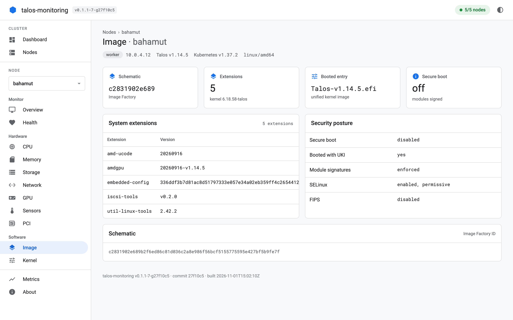

[Dark theme](assets/ui/node-image-dark.png)

## Kernel

Kernel version, boot command line, and tunables compared against their
defaults.

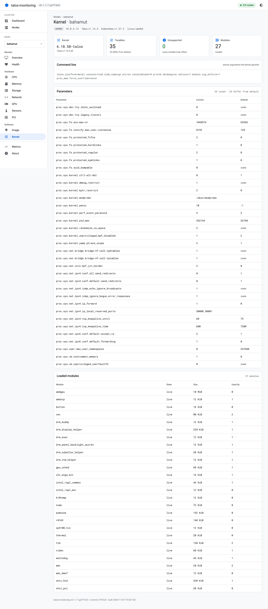

[Dark theme](assets/ui/node-kernel-dark.png)

## CPU

Usage breakdown, load average, per-core busy%/frequency, and the observed
frequency range.

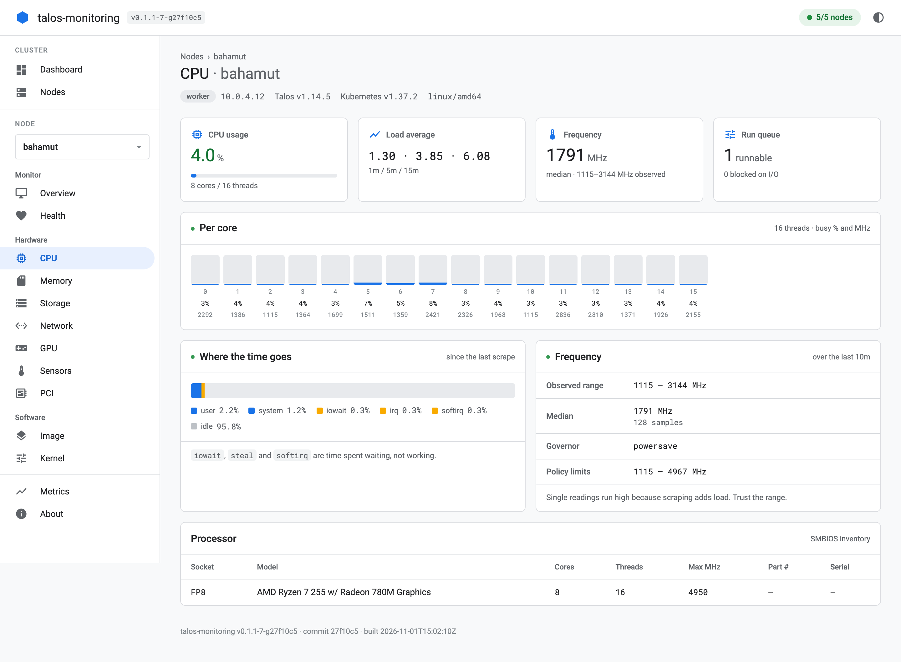

[Dark theme](assets/ui/node-cpu-dark.png)

## Memory

Usage, cache and buffers, swap, and per-DIMM inventory.

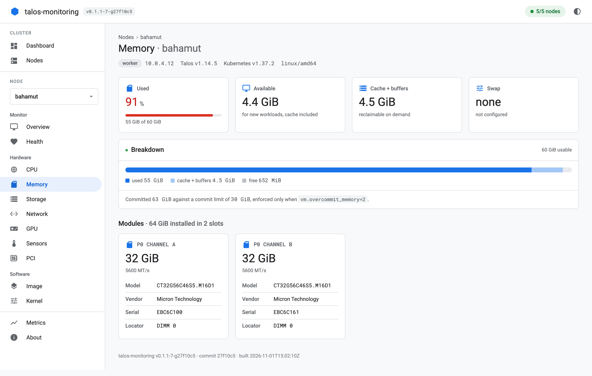

[Dark theme](assets/ui/node-memory-dark.png)

## Storage

Local capacity, physical block devices, Talos volumes, and
PersistentVolumes.

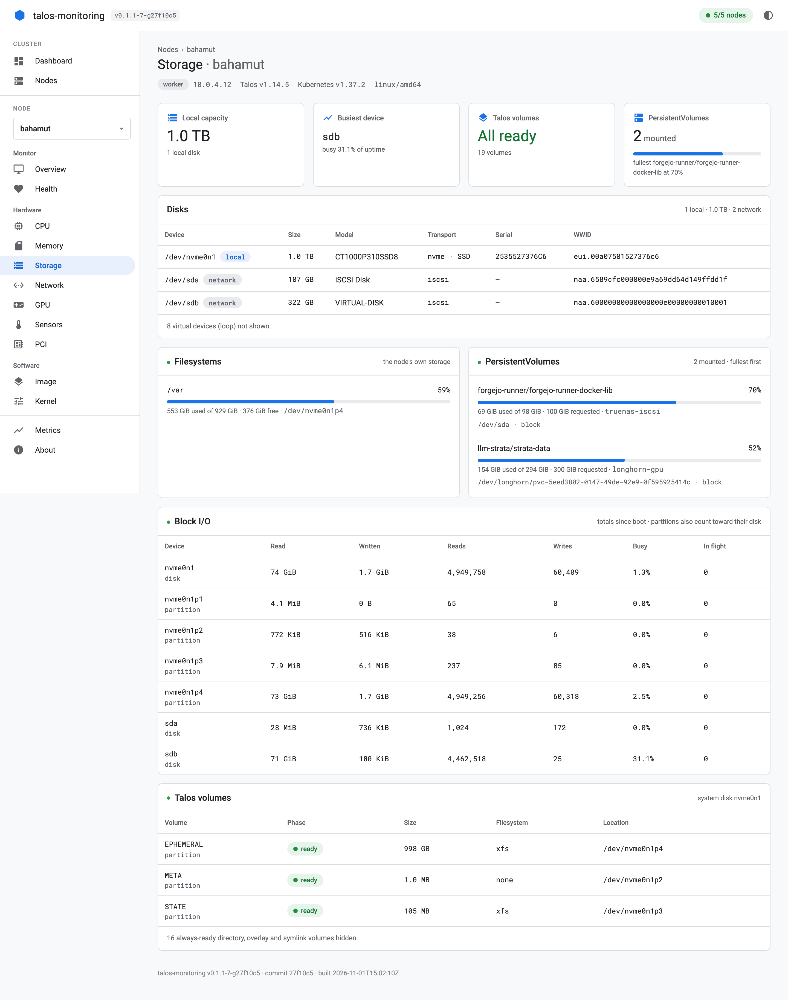

[Dark theme](assets/ui/node-storage-dark.png)

## Network

Interfaces, throughput, and cumulative counters (errors/drops) since boot.

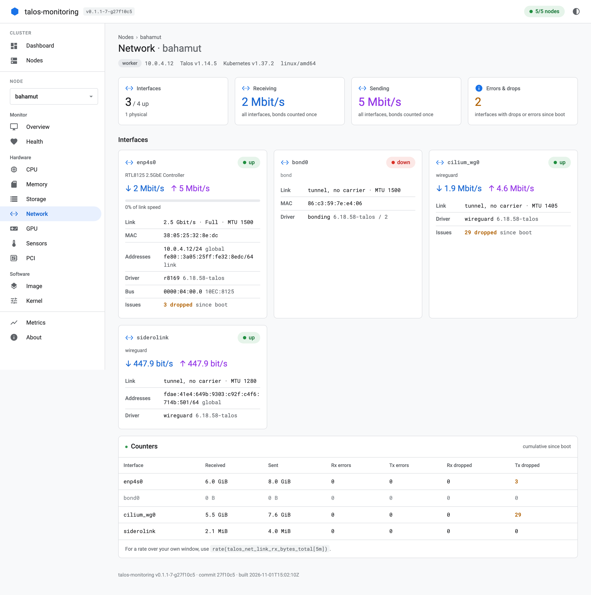

[Dark theme](assets/ui/node-network-dark.png)

## GPU

Per-card utilisation, video memory, and thermals/power from GPU hwmon
chips.

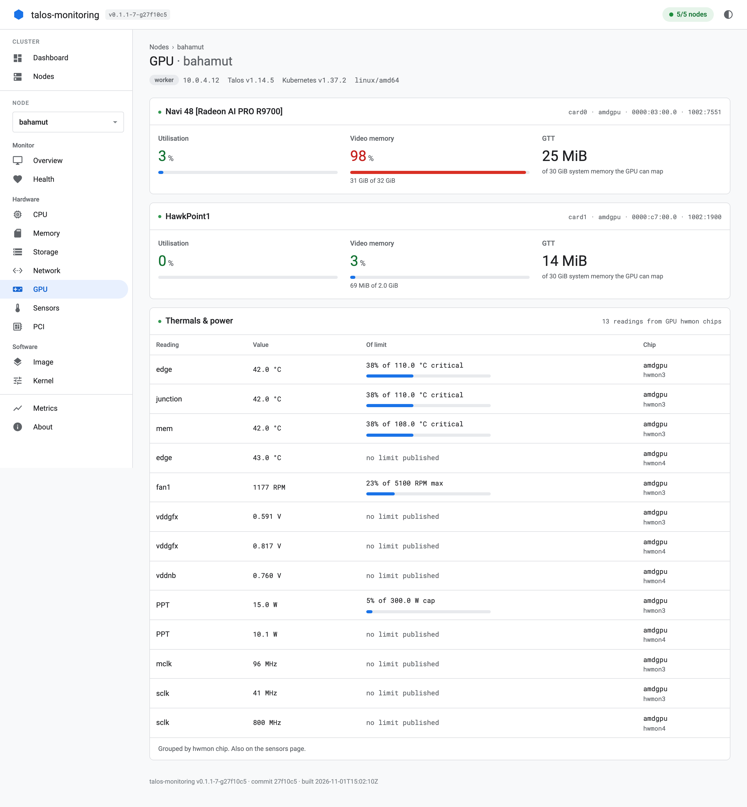

[Dark theme](assets/ui/node-gpu-dark.png)

## PCI

Discovered PCI devices grouped by class.

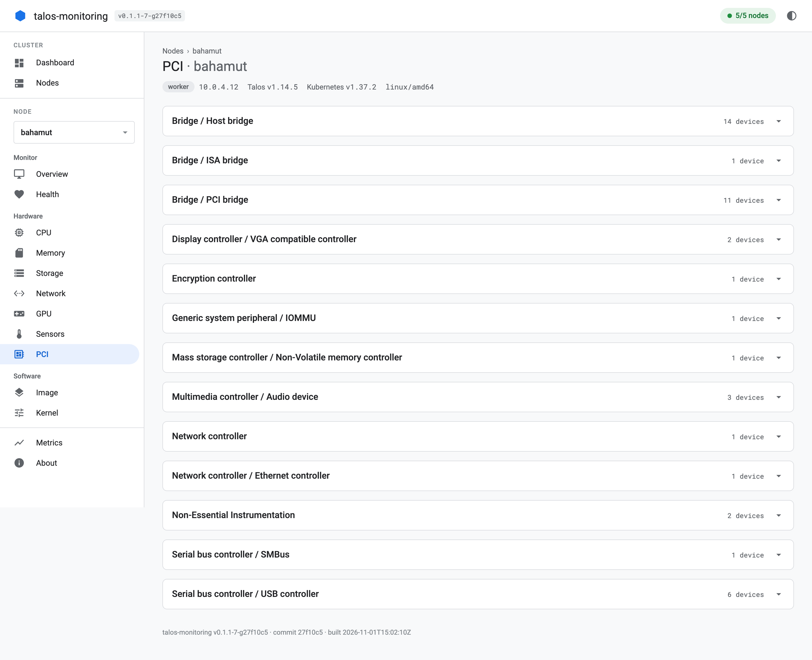

[Dark theme](assets/ui/node-pci-dark.png)

## Sensors

Temperature, voltage, power, and frequency readings across all hwmon
chips, with limits where reported.

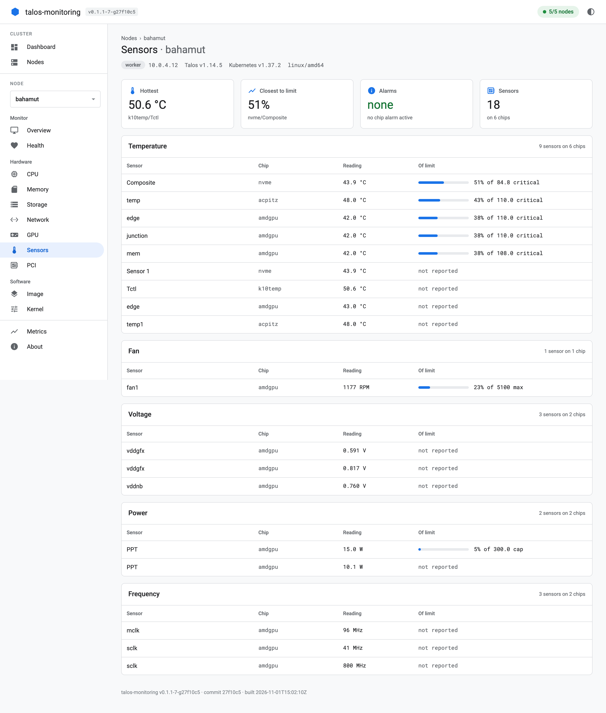

[Dark theme](assets/ui/node-sensors-dark.png)

## About

Build version, commit and date, and the scrape and probe endpoints.

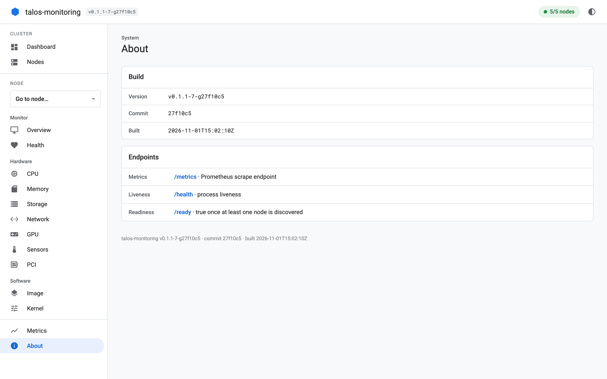

[Dark theme](assets/ui/about-dark.png)

Node pages were captured on a worker with two AMD GPUs, served with an
`os:admin` talosconfig: on `os:reader` the GPU thermals and the sensors page
show a permission notice instead (see **Roles** under the README's
[Prerequisites](../README.md#prerequisites)).
